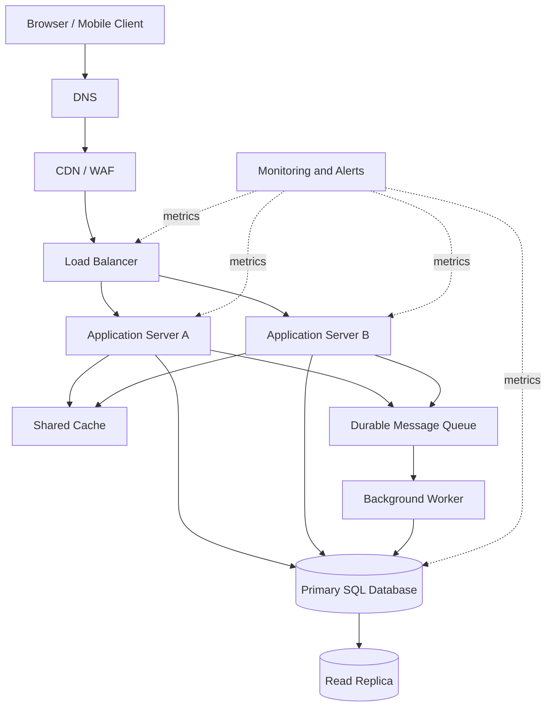

# QuickNotes System Architecture

## 1. Requirements

### Functional requirements
- Users can register, sign in, and sign out.
- Authenticated users can create, list, view, update, and delete their own notes.
- Users can create tags and attach multiple tags to notes.
- The API validates input and returns consistent success and error responses.
- Users cannot access notes owned by another user.

### Non-functional requirements
- Availability target: 99.9% monthly for the API.
- Typical read response target: under 300 ms at the 95th percentile, excluding slow client networks.
- Encrypt traffic with HTTPS and protect stored credentials with strong password hashing.
- Scale app servers horizontally and monitor latency, errors, saturation, and queue depth.
- Back up the database and test recovery regularly.
- Apply rate limits, authentication, authorization, and input validation.

## 2. Capacity estimate for 1 million users

These are planning assumptions, not measured production data.

Assumptions:
- 1,000,000 registered users.
- 10% active daily: 100,000 daily active users.
- Each active user performs 50 reads and 5 writes per day.
- Peak traffic is estimated at 10 times the daily average.
- Average stored note payload is 2 KB; each active user creates 2 notes per day.
- Storage estimate excludes indexes, replicas, backups, logs, and media.

Average reads/sec = 100,000 × 50 ÷ 86,400 ≈ **58 reads/sec**.
Average writes/sec = 100,000 × 5 ÷ 86,400 ≈ **5.8 writes/sec**.
Estimated peak = approximately **580 reads/sec** and **58 writes/sec** using the 10× peak factor.

Annual new note storage = 100,000 × 2 notes/day × 2 KB × 365
≈ 146,000,000 KB, or approximately **146 GB/year** (decimal units). Indexes, replicas, backups, and growth add overhead, so storage planning should budget substantially more than this base estimate.

## 3. Architecture diagram

## 4. Component responsibilities

- **Client:** provides the user interface and sends HTTPS requests to the API.
- **DNS:** resolves the public API hostname to the service entry point.
- **CDN/WAF:** caches suitable static assets and filters common malicious traffic before it reaches the app.
- **Load balancer:** distributes requests across healthy app servers and removes unhealthy instances from rotation.
- **Application servers A and B:** run the stateless API, validate requests, enforce permissions, and apply business rules; two instances allow horizontal scaling.
- **Shared cache:** stores frequently read data briefly to reduce database load; cache entries must be invalidated or expire when notes change.
- **Primary database:** accepts writes and provides the authoritative transactional record.
- **Read replica:** serves eligible read traffic and reduces load on the primary; replication lag means very recent writes may not immediately appear.
- **Durable queue:** holds background work such as notifications and exports so API requests do not wait for slow tasks.
- **Worker:** consumes queued jobs, retries transient failures, and uses idempotency to avoid duplicate side effects.
- **Monitoring and alerts:** track errors, latency, resource usage, replication lag, and queue depth so failures can be detected quickly.

## 5. Request flows

### GET `/v1/notes`
1. The client resolves the API hostname through DNS and sends an HTTPS request.
2. CDN/WAF applies edge rules and forwards the API request to the load balancer.
3. The load balancer selects a healthy application server.
4. The app validates the access token and extracts the user ID.
5. The app checks the shared cache for a user-scoped list result.
6. On a cache miss, the app queries the read replica when eventual consistency is acceptable; otherwise it queries the primary.
7. The app applies ownership filters and pagination, then caches an eligible result.
8. The app returns `200 OK` with notes and pagination metadata.

### POST `/v1/notes`
1. The client sends the note JSON over HTTPS.
2. DNS, edge protection, and the load balancer route the request to a healthy app server.
3. The app validates the access token, title length, and request body.
4. The app inserts the note into the primary database in a transaction.
5. The app invalidates relevant user-scoped cache entries.
6. If follow-up work is needed, the app publishes a job to the durable queue.
7. The app returns `201 Created` with the saved note and its ID. The worker processes queued work separately.

## 6. Trade-offs and reliability

### Trade-off A: Cache speed vs freshness
Caching reduces repeated database reads and latency, but cached notes can be briefly stale. Use short TTLs, invalidate user-specific keys after writes, and bypass cache for read-after-write requests when necessary.

### Trade-off B: Read replicas vs consistency
A replica increases read capacity but may lag behind the primary. Route writes and consistency-sensitive reads to the primary; monitor replication lag and keep a fallback path to the primary with rate limits.

### Trade-off C: Queue-based work vs immediate completion
A queue keeps slow background work outside the request path, but adds operational complexity and eventual completion. Use durable messages, retries with backoff, dead-letter handling, and idempotent workers.

## 7. Avoiding single points of failure

- Run at least two app-server instances across separate failure domains behind health-checked load balancing.
- Use a highly available managed database or a tested primary failover setup, with automated backups and point-in-time recovery.
- Deploy the cache and queue in replicated/managed configurations and define behaviour when either is temporarily unavailable.
- Use redundant DNS and multi-zone edge/load-balancing services where supported.
- Monitor service health and rehearse recovery procedures instead of relying on architecture diagrams alone.
